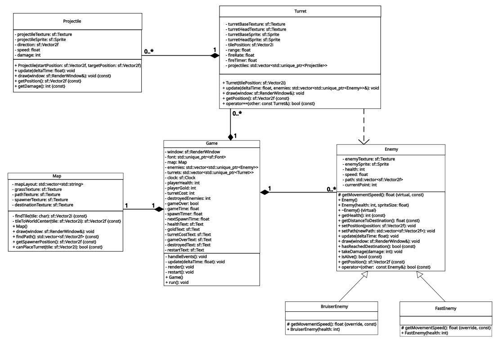
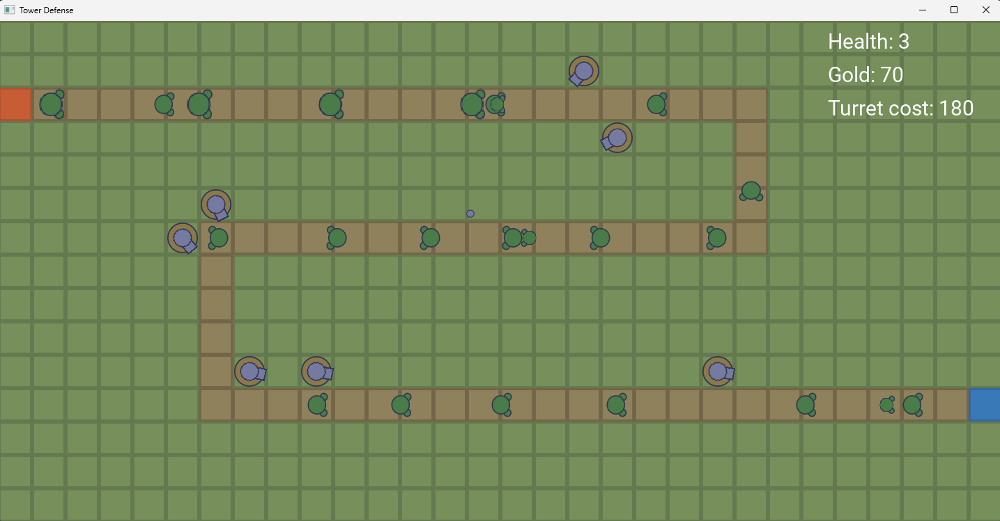
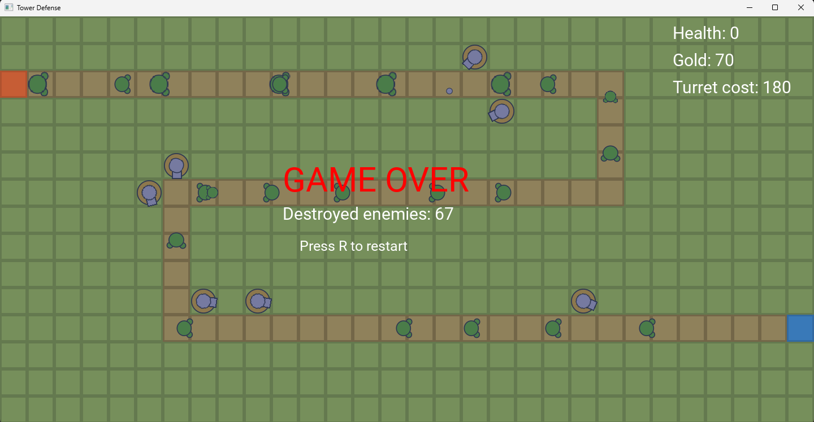

# Tower Defense

A Tower Defense game developed in **C++** using **SFML 3.1.0**.

All game graphics and the UML class diagram were created using **Inkscape**.

## 1. Game Features & Mechanics

- Defend the destination point (blue square) from incoming enemies by strategically placing turrets.
    
- Turrets can only be placed on grass tiles.
    
- Each turret automatically targets enemies within its range and fires projectiles.
    
- Turret heads rotate towards their selected targets.
    
- Three enemy types are available:
    
    - **Enemy** – standard enemy.
        
    - **FastEnemy** – moves faster but has less health.
        
    - **BruiserEnemy** – moves slower but has more health.
        
- Enemies spawn individually at random time intervals.
    
- Enemy health increases as the game progresses.
    
- The player starts with **3 lives**.
    
- Every enemy that reaches the destination costs the player one life.
    
- Killing an enemy rewards the player with gold.
    
- The cost of each new turret increases after every purchase.
    
- The game ends when the player runs out of lives.
    
- Press **R** to restart the game.
    

A single playthrough lasts approximately **3 minutes**, depending on the strategic placement of turrets.

---

## 2. Project Architecture & OOP Concepts + UML

The project is organized into separate header (`.h`) and source (`.cpp`) files to keep class declarations and implementations organized.

### Main Classes

- **Game** – manages the game loop, events, enemies, turrets, player resources and rendering.
    
- **Map** – stores and draws the map, checks turret placement and finds the path from the spawner to the destination using the Breadth-First Search (BFS) algorithm.
    
- **Enemy** – base class responsible for enemy movement, health, damage and path following.
    
- **FastEnemy** – derived from `Enemy`, represents a faster enemy with less health.
    
- **BruiserEnemy** – derived from `Enemy`, represents a slower enemy with more health.
    
- **Turret** – handles targeting, rotation, firing and projectile management.
    
- **Projectile** – handles projectile movement, position and damage.
    

### OOP Concepts

The project demonstrates the following object-oriented programming concepts:

- **Encapsulation** – class attributes are protected using access specifiers such as `private`, `protected` and `public`.
    
- **Inheritance** – `FastEnemy` and `BruiserEnemy` inherit from the base `Enemy` class.
    
- **Polymorphism** – virtual methods and method overriding allow different enemy types to use their own movement speeds. Enemies are stored using `std::unique_ptr<Enemy>`.
    
- **Operator Overloading** – `Enemy::operator<` is used to compare enemies by their remaining distance to the destination point, while `Turret::operator==` checks whether two turrets occupy the same tile.
    
- **Exception Handling** – invalid map configurations and missing paths are handled using exceptions (`throw` and `try-catch`).
    
- **STL Containers** – `std::vector`, `std::queue` and smart pointers (`std::unique_ptr`) are used to manage game objects and implement BFS.
    

### UML Class Diagram



---

## 3. How to Compile and Run

### Requirements

- C++ compiler compatible with the project.
    
- CMake.
    
- Git.
    

### Option 1: Using Visual Studio

1. Open Visual Studio.
    
2. Select **Open a local folder**.
    
3. Select the cloned `TowerDefense` project folder.
    
4. Wait for CMake configuration and all required downloads to complete.
    
5. Select the game startup target and run the project.
    

### Option 2: Without Visual Studio

1. Check whether CMake is installed:
    
    ```
    cmake --version
    ```
    
2. If CMake is not installed, install it using Windows Package Manager:
    
    ```
    winget install Kitware.CMake
    ```
    
3. Clone the repository:
    
    ```
    git clone https://github.com/22SergioGG/TowerDefense.git
    ```
    
4. Navigate to the project directory:
    
    ```
    cd TowerDefense
    ```
    
5. Configure the project:
    
    ```
    cmake -B build
    ```
    
6. Build the project:
    
    ```
    cmake --build build --config Debug
    ```
    

After a successful build, run the generated executable from the build directory.

---

## 4. Game Screenshots

### Gameplay

### Game Over
